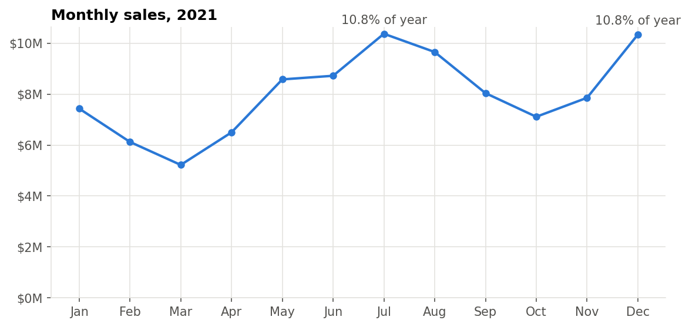
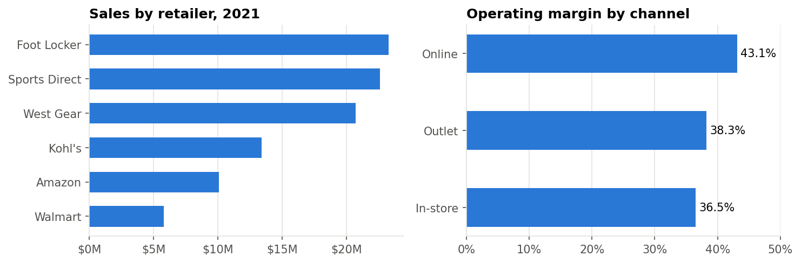

# Adidas US Sales - EDA in Python

Analysis of Adidas sales through six US retailers, in one notebook:
[`adidas_sales_eda.ipynb`](adidas_sales_eda.ipynb). Data: [Kaggle - Adidas Sales Dataset](https://www.kaggle.com/datasets/heemalichaudhari/adidas-sales-dataset).

## First, the data was wrong

In 3,886 of the 9,648 rows (40%), total sales is exactly 10 times price x units sold. All in-store
rows have this error, plus about a third of online and outlet rows. If you use the reported
numbers, sales come out at $900M instead of $120M, and in-store looks like the biggest channel when
it's actually the smallest.

I rebuilt sales as price x units and profit as sales x operating margin.

2020 is also incomplete (no Amazon data, far fewer records for the others), so I only analysed
2021.

## 2021 results

$95.9M sales, $38.2M operating profit (39.8% margin), 2.0M units.

- **Online** is the biggest channel (42% of sales) and has the best margin: 43.1%, vs 36.5%
  in-store. Online prices are actually lower than in-store for every product, so the difference
  is in costs, not pricing.
- **Foot Locker, Sports Direct and West Gear** make up 70% of sales. Walmart is smallest, with the
  lowest margin (35.3%).
- **Men's street footwear** is the largest line (23.7%). Women's apparel has the best margin
  (42.1%) and highest average price ($54).
- **The West** sells the most (27.5%) at the lowest margin (36.3%). The South has the best margin
  (45.5%) at the lowest prices.
- Sales peak in July and December and are lowest in March.

To run: put `Adidas US Sales Datasets.xlsx` in `data/` and open the notebook (needs pandas,
matplotlib and openpyxl).
